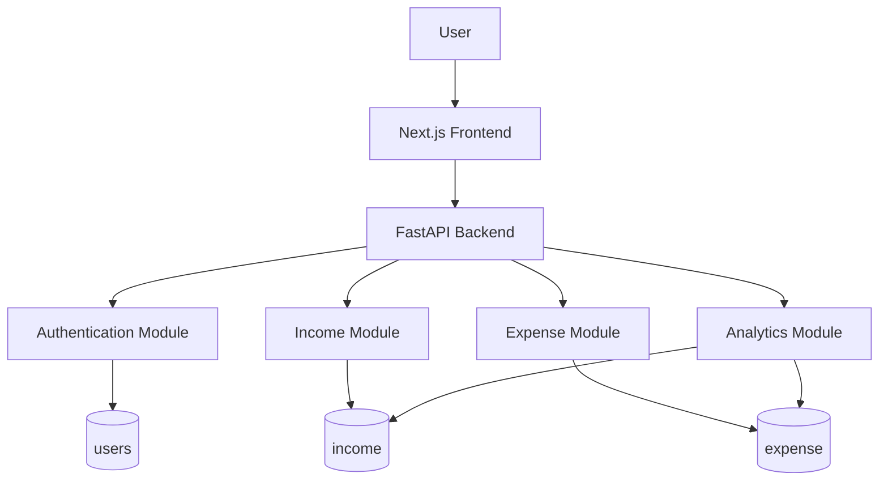
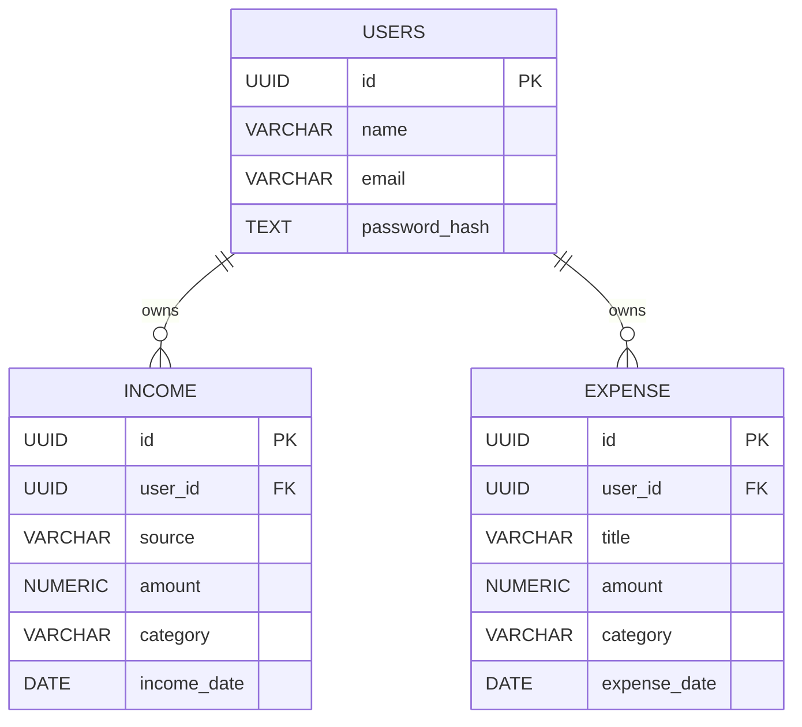
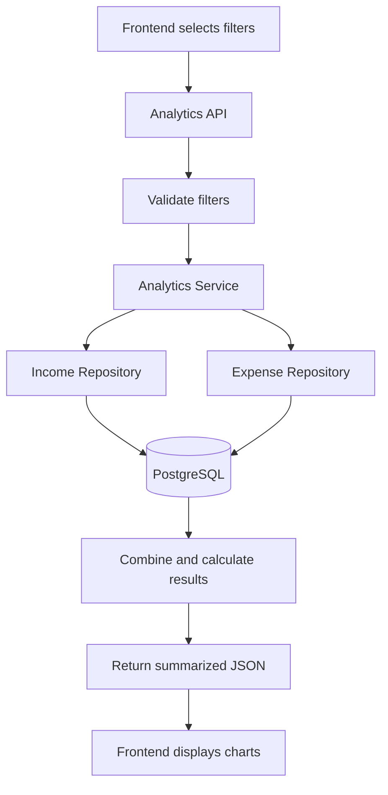

# AI-Powered Expense Tracker
## Backend Requirements & Initial System Design (MVP)

## 1. Project Overview

Build the backend for an AI-Powered Expense Tracker using Python, FastAPI, and PostgreSQL.

The initial version will focus on basic expense management and financial analysis. AI functionalities will be integrated in later development phases.

### Initial Features

Users should be able to:
- Sign up and log in.
- Create, view, update, and delete income records.
- Create, view, update, and delete expense records.
- View income and expense history.
- Filter records by date, month, year, and category.
- Analyze total income, expenses, and remaining balance.
- View monthly, yearly, daily, and category-wise financial analysis.

## 2. Technology Stack

| Component | Technology |
|---|---|
| Backend Framework | FastAPI |
| Programming Language | Python |
| Database | PostgreSQL |
| ORM | SQLAlchemy |
| Data Validation | Pydantic |
| Database Migrations | Alembic |
| Authentication | JWT with secure HttpOnly cookies |
| Password Hashing | Argon2id |
| API Documentation | FastAPI Swagger |
| Testing | Pytest |

## 3. System Architecture

Follow a modular three-tier architecture.

### Presentation Layer
- Next.js frontend.
- Sends HTTP requests to backend APIs.
- Displays income, expenses, financial summaries, and charts.
- Sends filters such as date range, month, year, and category.

### Application Layer
- FastAPI backend.
- Handles authentication and authorization.
- Validates incoming requests.
- Implements income and expense business logic.
- Performs financial calculations.
- Handles analytics requests.

### Data Layer
- PostgreSQL database.
- Stores user accounts, income records, and expense records.
- Handles filtering, aggregation, and grouping through SQL queries.

### Architecture Diagram



## 4. Database Design

For the initial MVP, use three main database tables:

1. `users`
2. `income`
3. `expense`

Do not create a combined transactions table or a separate categories table in this initial version.

Categories will initially be stored as string values in the income and expense tables.

### 4.1 Users Table

| Column | Data Type | Constraints |
|---|---|---|
| id | UUID | Primary Key |
| name | VARCHAR(100) | NOT NULL |
| email | VARCHAR(255) | UNIQUE, NOT NULL |
| password_hash | TEXT | NOT NULL |
| created_at | TIMESTAMPTZ | DEFAULT NOW() |
| updated_at | TIMESTAMPTZ | DEFAULT NOW() |

Requirements:
- Every user must have a unique email.
- Passwords must be securely hashed.
- Never store plain-text passwords.
- Use UUIDs for primary keys.

### 4.2 Income Table

Stores all income records belonging to users.

| Column | Data Type | Constraints |
|---|---|---|
| id | UUID | Primary Key |
| user_id | UUID | Foreign Key → users.id |
| source | VARCHAR(100) | NOT NULL |
| amount | NUMERIC(12,2) | NOT NULL |
| category | VARCHAR(50) | NOT NULL |
| description | TEXT | NULLABLE |
| income_date | DATE | NOT NULL |
| created_at | TIMESTAMPTZ | DEFAULT NOW() |
| updated_at | TIMESTAMPTZ | DEFAULT NOW() |

Example categories:
- Salary
- Freelance
- Business
- Investment
- Scholarship
- Gift
- Other

Example record:

```json
{
  "source": "Monthly Salary",
  "amount": "25000.00",
  "category": "Salary",
  "description": "November salary",
  "income_date": "2026-11-01"
}
```

### 4.3 Expense Table

Stores all expense records belonging to users.

| Column | Data Type | Constraints |
|---|---|---|
| id | UUID | Primary Key |
| user_id | UUID | Foreign Key → users.id |
| title | VARCHAR(100) | NOT NULL |
| amount | NUMERIC(12,2) | NOT NULL |
| category | VARCHAR(50) | NOT NULL |
| description | TEXT | NULLABLE |
| expense_date | DATE | NOT NULL |
| created_at | TIMESTAMPTZ | DEFAULT NOW() |
| updated_at | TIMESTAMPTZ | DEFAULT NOW() |

Example categories:
- Food
- Transport
- Shopping
- Education
- Entertainment
- Healthcare
- Rent
- Bills
- Other

Example record:

```json
{
  "title": "Grocery Shopping",
  "amount": "850.00",
  "category": "Food",
  "description": "Weekly groceries",
  "expense_date": "2026-11-08"
}
```

### 4.4 Database Relationships

- One user can have multiple income records.
- One user can have multiple expense records.
- Every income record belongs to exactly one user.
- Every expense record belongs to exactly one user.

### ER Diagram



### 4.5 Database Constraints and Indexes

Implement the following:
- Amount must be greater than zero.
- Email must be unique.
- Income and expense records must reference an existing user.
- Use appropriate indexes on `user_id` and date columns.
- Validate category values in the backend.
- Prevent users from accessing or modifying another user's records.

Recommended indexes:

```sql
CREATE INDEX idx_income_user_date
ON income(user_id, income_date);

CREATE INDEX idx_expense_user_date
ON expense(user_id, expense_date);

CREATE INDEX idx_expense_user_category
ON expense(user_id, category);
```

## 5. Backend Architecture and Code Organization

Follow a modular architecture with separation of responsibilities.

```text
backend/
│
├── app/
│   ├── main.py
│   │
│   ├── api/
│   │   ├── dependencies.py
│   │   └── routes/
│   │       ├── auth.py
│   │       ├── income.py
│   │       ├── expense.py
│   │       └── analytics.py
│   │
│   ├── core/
│   │   ├── config.py
│   │   └── security.py
│   │
│   ├── db/
│   │   ├── session.py
│   │   └── base.py
│   │
│   ├── models/
│   │   ├── user.py
│   │   ├── income.py
│   │   └── expense.py
│   │
│   ├── schemas/
│   │   ├── auth.py
│   │   ├── income.py
│   │   ├── expense.py
│   │   └── analytics.py
│   │
│   ├── services/
│   │   ├── auth_service.py
│   │   ├── income_service.py
│   │   ├── expense_service.py
│   │   └── analytics_service.py
│   │
│   └── repositories/
│       ├── user_repository.py
│       ├── income_repository.py
│       └── expense_repository.py
│
├── migrations/
├── tests/
├── requirements.txt
├── .env.example
└── README.md
```

### Responsibilities

- **Routes:** Define API endpoints and handle HTTP requests.
- **Schemas:** Validate incoming and outgoing data using Pydantic.
- **Models:** Define SQLAlchemy database models.
- **Services:** Implement business logic and financial calculations.
- **Repositories:** Handle database queries and CRUD operations.
- **Core:** Manage configuration and security.
- **DB:** Handle database connection and session management.

## 6. API Design

Use `/api/` as the common prefix for all endpoints. Do not include a version prefix.

### 6.1 Authentication APIs

| Method | Endpoint | Purpose |
|---|---|---|
| POST | `/api/auth/signup` | Register a new user |
| POST | `/api/auth/login` | Authenticate user |
| POST | `/api/auth/logout` | Logout user |
| GET | `/api/auth/me` | Get current user information |

### 6.2 Income APIs

| Method | Endpoint | Purpose |
|---|---|---|
| POST | `/api/income` | Create income |
| GET | `/api/income` | Get income records |
| GET | `/api/income/{id}` | Get specific income |
| PUT | `/api/income/{id}` | Update income |
| DELETE | `/api/income/{id}` | Delete income |

The GET endpoint should support:
- `start_date`
- `end_date`
- `month`
- `year`
- `category`
- `page`
- `limit`

### 6.3 Expense APIs

| Method | Endpoint | Purpose |
|---|---|---|
| POST | `/api/expenses` | Create expense |
| GET | `/api/expenses` | Get expense records |
| GET | `/api/expenses/{id}` | Get specific expense |
| PUT | `/api/expenses/{id}` | Update expense |
| DELETE | `/api/expenses/{id}` | Delete expense |

The GET endpoint should support:
- `start_date`
- `end_date`
- `month`
- `year`
- `category`
- `page`
- `limit`

### 6.4 Analytics APIs

| Method | Endpoint | Purpose |
|---|---|---|
| GET | `/api/analytics/summary` | Total income, expense, and balance |
| GET | `/api/analytics/monthly` | Monthly income and expense breakdown |
| GET | `/api/analytics/categories` | Category-wise expense breakdown |
| GET | `/api/analytics/daily` | Daily income and expense breakdown |
| GET | `/api/analytics/trends` | Spending trends over time |

Analytics endpoints should support relevant filters such as:
- `start_date`
- `end_date`
- `month`
- `year`
- `category` (where applicable)

Define clear validation rules for conflicting filters.

## 7. Analytics Implementation

Analytics must be calculated on the backend using PostgreSQL queries and backend business logic.

Do not send all income and expense records to the frontend for calculating summaries or charts.

### 7.1 Financial Summary

Calculate:
- Total income
- Total expenses
- Net balance

Formula:

```text
Net Balance = Total Income - Total Expenses
```

Example response:

```json
{
  "total_income": "30000.00",
  "total_expense": "12000.00",
  "net_balance": "18000.00"
}
```

### 7.2 Monthly Analytics

Group income and expenses by month and year.

### 7.3 Category-wise Expense Analysis

Group expense records by category and calculate the total amount for each category.

### 7.4 Daily Analytics

Group income and expenses by date for a selected date range.

### 7.5 Analytics Data Flow



### Important Data Handling Rule

- Frontend: Select filters and display results.
- Backend: Validate filters and calculate financial summaries.
- Database: Retrieve and aggregate relevant records.

For individual transaction history, return paginated records.

For analytics, return aggregated results rather than all individual records.

Always derive the user ID from the authenticated user context, never trust a user ID supplied by the frontend.

## 8. Authentication and Security

Implement:
1. Password hashing using Argon2id.
2. JWT-based authentication.
3. Secure HttpOnly authentication cookies.
4. Logout and token/session invalidation.
5. Protected income, expense, and analytics endpoints.
6. User-level data isolation.
7. Pydantic request validation.
8. Parameterized database queries.
9. CORS configuration for the frontend origin.
10. CSRF protection for cookie-based authentication.

## 9. Development Guidelines

- Follow separation of concerns.
- Use SQLAlchemy for database operations.
- Use Alembic for database migrations.
- Use UUIDs as primary keys.
- Use NUMERIC/DECIMAL for monetary values, never FLOAT.
- Use proper HTTP status codes.
- Implement consistent error responses.
- Add pagination to record-listing APIs.
- Add indexes for frequently filtered columns.
- Store secrets in environment variables.
- Never expose passwords or tokens.
- Write unit and integration tests.
- Avoid unnecessary abstractions and premature optimization.

## 10. Scope Exclusions — Initial MVP

Do not implement the following features in this phase:
- AI expense categorization.
- AI chatbot or financial assistant.
- Receipt scanning and OCR.
- AI-generated financial insights.
- Expense forecasting.
- Bank account integration.
- Vector database or RAG.
- Recurring expense automation.

Keep the architecture extensible so these features can be introduced later.

## 11. Implementation Order

**Phase 1: Project Setup**
- Initialize FastAPI.
- Configure PostgreSQL.
- Setup SQLAlchemy and Alembic.
- Create project structure.

**Phase 2: Database**
- Implement User, Income, and Expense models.
- Create migrations.
- Add constraints and indexes.

**Phase 3: Authentication**
- Implement signup and login.
- Implement password hashing.
- Implement protected routes and logout.

**Phase 4: Income and Expense Management**
- Implement CRUD APIs.
- Add validation.
- Implement filtering and pagination.
- Ensure user-level data isolation.

**Phase 5: Analytics**
- Implement summary calculations.
- Implement monthly analysis.
- Implement category-wise analysis.
- Implement daily analysis and trends.
- Return structured JSON responses.

**Phase 6: Testing**
- Test authentication.
- Test income and expense CRUD operations.
- Test authorization and data isolation.
- Test filtering and pagination.
- Verify analytics calculations.

## 12. Expected MVP Outcome

At the end of implementation, the backend should provide:
- Working user authentication.
- Complete income management.
- Complete expense management.
- Secure user-specific data access.
- Filtering and pagination.
- Monthly and yearly financial analysis.
- Category-wise expense analysis.
- Daily income and expense summaries.
- Documented REST APIs through Swagger.

The backend must be ready for integration with the Next.js frontend.

**Future Direction:** AI functionalities will be introduced as separate modules using the existing income, expense, and analytics data without disrupting the core backend architecture.